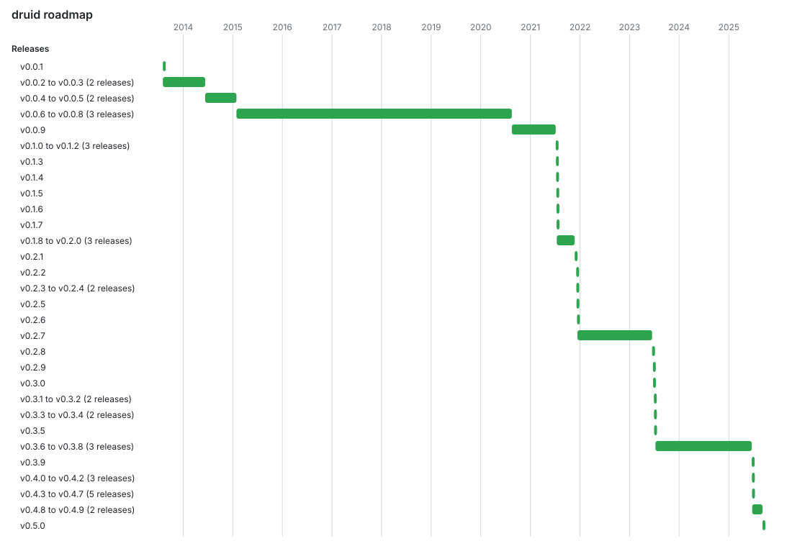
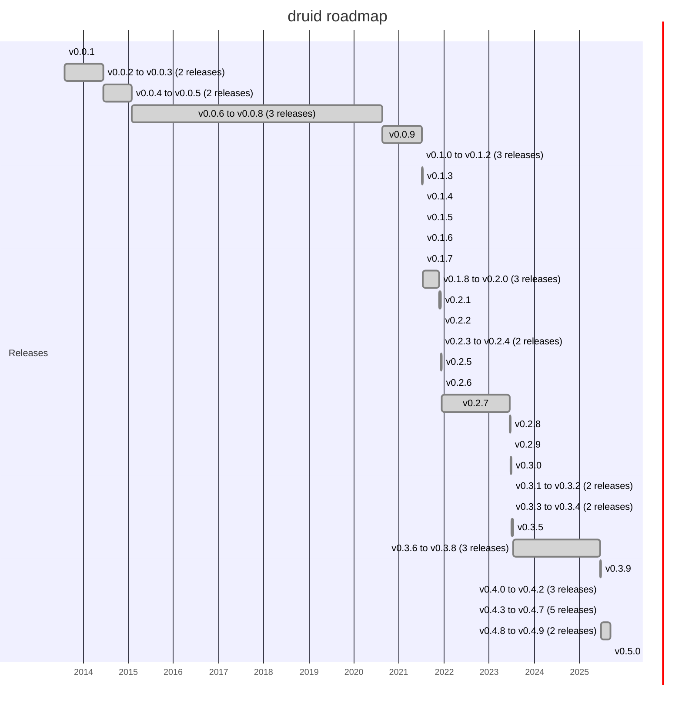

# kopi

Version: 1.0.4

**KOPI: Keep Our Projects In-sync.** Create and manage GitHub Projects (v2) from the command line, and keep them in step with your repo's `CHANGELOG.md`, `TODO.md`, issues and PRs. Wraps the `gh` CLI, so it needs no dependencies beyond Python 3.9+ and an authenticated `gh` with the `project` scope (`gh auth refresh -s project`).

## Contents

- [Quick start](#quick-start)
- [Usage](#usage)
- [Settings and options](#settings-and-options): [owner](#choosing-the-owner), [`.kopi.toml`](#settings-file-kopitoml), [Status names](#boards-with-other-status-names---status-map), [other repos](#running-against-another-repo), [JSON output](#json-output---json), [limits](#limits)
- [Projects](#projects): [list](#listing-projects), [`--init`](#initialising-a-project-for-a-repo), [`set`](#setting-field-values-set)
- [Files to board](#files-to-board): [`--import`](#importing-changelogmd-todomd-issues-and-prs), [`--update`](#updating-the-project-from-changelogmd-todomd-issues-and-prs), [`--diff`](#comparing-the-project-with-the-files---diff), [`--sync`](#syncing-both-ways---sync), [extra sources](#extra-sources---code-comments---releases), [single files](#importing-or-updating-a-single-file)
- [Board to files](#board-to-files): [`--export`](#exporting-board-items-to-todomd---export), [`--squash`](#ticking-todomd-from-the-board---squash), [issues and PRs](#issues-and-prs)
- [Working on items](#working-on-items): [`--list`](#listing-items---list), [`--done` / `--start` / `--move`](#moving-items---done---start---move), [`--promote`](#promoting-drafts-to-issues---promote---promote-all), [`--open`](#opening-an-issue---open), [`--close`](#closing-an-issue---close), [`--reopen`](#reopening-an-issue---reopen), [`--archive`](#archiving-stale-items---archive), [`--restore`](#restoring-archived-items---restore), [`--dedupe`](#removing-duplicates---dedupe)
- [Roadmap dates](#roadmap-dates): [`--setup-dates`, `--backfill-dates`](#roadmap-dates), [`--gantt`](#gantt-chart-of-the-roadmap---gantt)
- [Releases](#creating-a-release---release)
- [Reports](#reports): [`--report`](#progress-report---report), [`--rollup`](#roll-up-across-projects---rollup)

## Quick start

```
gh auth login && gh auth refresh -s project                  # once
cd ~/code/my-repo
./kopi.py --import --dry-run                                 # see what would be seeded from CHANGELOG.md, TODO.md, issues and PRs
./kopi.py --import                                           # create the project and fill it
./kopi.py --sync                                             # later: keep the board and TODO.md level
./kopi.py --diff --check                                     # or gate CI on them being in sync
./kopi.py --report                                           # how are we doing?
```

## Usage

```
# Projects
./kopi.py list [--closed]                                    # number, title, open/closed, linked repo, URL
./kopi.py create "Title" --repo owner/repo                   # create project with title and linked repo
./kopi.py view N                                             # view project by number
./kopi.py delete N                                           # delete project by number
./kopi.py fields N                                           # show project fields by number
./kopi.py items N                                            # show project items by number
./kopi.py set N ITEM --field NAME (--value V | --clear)      # set a field value on one item
./kopi.py add N --url <issue-or-pr-url>                      # or --title "draft item"

# Files to board
./kopi.py --init [PATH]                                      # ensure the current repo has a project
./kopi.py --import [PATH|FILE] [--dry-run] [--force]         # seed the project from CHANGELOG.md, TODO.md, issues and PRs
./kopi.py --update [PATH|FILE] [--dry-run]                   # sync CHANGELOG.md / TODO.md / issue / PR changes into the project
./kopi.py --diff [PATH] [--check]                            # show how the project differs from the files (--check: exit 2 if it does)
./kopi.py --sync [PATH] [--dry-run]                          # --update then --squash: files/GitHub -> board, Done on board -> ticks in TODO.md
./kopi.py --import|--update --code-comments --releases       # also track TODO:/FIXME: comments and git tags (opt-in)

# Board to files
./kopi.py --export todo|inprogress|done [--dry-run]          # add the board's items to TODO.md as [ ] / [~] / [x] entries
./kopi.py --export issues [--dry-run] [--force]              # write the board's issues to ISSUES.md
./kopi.py --export prs [--dry-run] [--force]                 # write the board's pull requests to PRS.md
./kopi.py --squash [PATH] [--dry-run] [--force]              # tick TODO.md entries that are Done on the board; refresh ISSUES.md
./kopi.py --import issues [--dry-run]                        # create a GitHub issue for each ISSUES.md entry that has none

# Working on items
./kopi.py --list todo|inprogress|done [--local]              # list the project's items by status (or the matching entries in TODO.md)
./kopi.py --list issues|prs [--local]                        # list the project's issue / PR items (or the entries in ISSUES.md / PRS.md)
./kopi.py --list releases [--local]                          # list the repo's GitHub releases (or the versions in CHANGELOG.md)
./kopi.py --done ITEM [--dry-run]                            # move one board item to Done (ITEM: id or title text)
./kopi.py --start ITEM [--dry-run]                           # move one board item to In Progress
./kopi.py --move ITEM STATUS [--dry-run]                     # move one board item to any Status (Todo, In Progress, Done, ...)
./kopi.py --open TITLE [--body T] [--label L] [--dry-run]    # create a GitHub issue and add it to the project as Todo
./kopi.py --open|--reopen|--close ... --local                # only edit the local ISSUES.md, nothing on GitHub
./kopi.py --close ISSUE [--dry-run]                          # close a GitHub issue (ISSUE: number, URL or title text)
./kopi.py --reopen ISSUE [--dry-run]                         # reopen a closed issue and put it back on the project as Todo
./kopi.py --promote ITEM [--dry-run] [--annotate]            # turn one draft board item into a real issue (--annotate: add (#N) to TODO.md)
./kopi.py --promote-all [todo|inprogress] [--dry-run|--yes] [--annotate]  # ...or every open draft (needs --yes)
./kopi.py --archive [PATH] [--dry-run] [--force]             # archive open board drafts no longer in TODO.md
./kopi.py --archive [PATH] [--id ID | --match TEXT]          # archive one item
./kopi.py --restore [PATH] [--dry-run] [--id ID | --all]     # unarchive items that --archive archived (or all archived)
./kopi.py --dedupe [PATH] [--dry-run]                        # delete duplicate board items

# Reports
./kopi.py --setup-dates [--dry-run]                          # create the Started / Completed date fields (--import / --update do it too)
./kopi.py --backfill-dates [--dry-run]                       # fill the missing Started / Completed dates (--import / --update do it too; --no-dates skips)
./kopi.py --gantt [releases|items] [--to FILE]               # draw the Roadmap as a Gantt chart (ROADMAP.md / .svg / .mmd)
./kopi.py --release [TAG] [--tag TAG] [--draft] [--dry-run]  # create a GitHub release at the last commit (notes from CHANGELOG.md)
./kopi.py --delete release --tag TAG [--cleanup-tag] [--dry-run]   # delete a GitHub release (also: --delete release --release TAG)
./kopi.py --report [text|markdown]                           # progress summary of the project
./kopi.py --rollup [DIR ...]                                 # status counts across several repos' projects (or all open projects)

# Options for any of the above
./kopi.py --owner NAME ...                                   # user or org that owns the project (default: the repo's owner)
./kopi.py --status-map "Todo=Backlog,Done=Shipped" ...       # name the board's Status options if they differ
./kopi.py --config FILE ...                                  # read settings from FILE instead of ./.kopi.toml
./kopi.py --json <command or mode>                           # print the result as JSON
./kopi.py --version
```

## Settings and options

### Choosing the owner

`gh` needs to know which user or organisation owns the project. `kopi` picks it in this order:

1. `--owner NAME` if given.
2. `owner` in `.kopi.toml`, if set.
3. Otherwise, if run inside a git repo whose `origin` remote is on github.com, the owner of that repo (the organisation or user in `github.com/OWNER/REPO`). `kopi` prints `Using owner: OWNER (from git origin)` to stderr when it does this.
4. Otherwise `@me`, the authenticated user.

Note that `gh` only links a project to repos owned by the same owner (`create --repo`).

### Settings file (`.kopi.toml`)

Put a `.kopi.toml` in the repo's root to stop repeating flags. kopi reads `./.kopi.toml` (in the directory it works in, so `kopi --update ~/code/other-repo` reads that repo's file), or the file named by `--config FILE`. A missing default file is fine; a missing `--config` file is an error. Command-line flags always win.

```toml
owner = "lateralblast"        # same as --owner
project = "Roadmap"           # the board's title, if it is not the repo's name
repos = ["../ocicat"]         # default directories for --rollup

[status]                      # same as --status-map
Todo = "Backlog"
"In Progress" = "Doing"
Done = "Shipped"

[sources]                     # same as --code-comments / --releases
code_comments = true
releases = true

[dates]                       # names of the Roadmap date fields (these are the defaults)
started = "Started"
completed = "Completed"
enabled = true                # false: never create or fill the date fields

[release]                     # for --release
tag_prefix = "v"              # tag = prefix + changelog version (v1.2.3); --tag TAG still wins

[sections]                    # opt-in: a text field holding the TODO.md heading each item sat under
enabled = true
field = "Section"             # the field's name (this is the default)

[comments]                    # tuning of the code-comment scan
tags = ["TODO", "FIXME", "HACK"]
include = ["src/*"]           # only these paths (globs on the path or file name)
exclude = ["*_generated.py"]  # in addition to the built-in exclusions
```

- `project` is the title kopi looks for and, for `--init` / `--import`, creates.
- `[release] tag_prefix` is put before the changelog version to name the tag `--release` creates (`v` gives `v1.2.3`); without it the tag is the plain version number. An explicit `--tag` is used as typed.
- `[sections] enabled = true` makes `--import` / `--update` create a **Section** text field and fill it with the `##` heading each `TODO.md` entry sits under, so the board can be grouped by it. Existing values are never overwritten, changelog entries get none, and it is off by default.
- `repos` is described under [`--rollup`](#roll-up-across-projects---rollup), `[sources]` and `[comments]` under [extra sources](#extra-sources---code-comments---releases).
- Unknown settings are ignored with a warning on stderr, so a typo is visible; a value of the wrong type is an error.
- It is TOML. On Python 3.11+ the standard `tomllib` reads it; on older Pythons a small built-in parser handles the subset used here (tables, strings, integers, booleans and arrays), so kopi still needs no dependencies. Inline tables are not supported there.

### Boards with other Status names (`--status-map`)

kopi works with three statuses: **Todo**, **In Progress** and **Done**. If your board's Status field uses other option names, common ones are recognised automatically: Backlog, Open, Ready and Not started count as Todo; Doing, WIP, Started and Active as In Progress; Complete, Completed, Closed, Finished and Shipped as Done. For anything else, name them yourself:

```
kopi --status-map "Todo=Icebox,In Progress=Building,Done=Released" --update
```

Each pair is `Todo|In Progress|Done=OPTION`, and the option names are matched case-insensitively. Reading a board, kopi shows the statuses as Todo / In Progress / Done; writing one, it uses the board's own option (an exact `Todo` / `In Progress` / `Done` option is preferred if the board has one). If a status has no matching option, the command fails and names it, suggesting this flag. The flag is global, so put it before the command. It is not remembered between runs; use `[status]` in `.kopi.toml` for that.

### Running against another repo

`--init`, `--import`, `--update`, `--diff`, `--sync`, `--archive`, `--squash`, `--restore` and `--dedupe` work on the current directory by default. Give them a path to work on the repo there instead, for example `kopi --update ~/code/other-repo`. The path's `CHANGELOG.md`, `TODO.md`, `.kopi.toml` and git `origin` are used, so the project and owner are resolved from that repo. It must be a directory. Put the path right after the flag, before other options (`kopi --update PATH --dry-run`). The other modes take their value as something other than a path (an item, an issue, a kind) and always work on the current directory.

### JSON output (`--json`)

Add `--json` to any command or mode to print its result as one JSON document on stdout, for scripts (`kopi --json list | jq`). Human status messages are suppressed, while warnings and the `Using owner` notice still go to stderr. Shapes:

- `list`: array of `{number, title, state, repos, url}`; `fields` and `items`: the `gh` arrays; `view`: the project object (always JSON).
- `create`: `{number, url, linked_repo}`; `--init`: `{number, created}`; `delete`: `{deleted}`; `add`: `{added}`; `set`: `{project, dry_run, item, field, value}`.
- `--import` and `--update`: `{project, dry_run, added: [{status, title, url?}], moved: [{title, from, to}]}` (`--import` reports `items`, `skipped` on a dry run and `imported` otherwise).
- `--diff`: `{project, files_only, github_only, board_only, duplicates, behind, ahead, in_sync}`.
- `--sync`: `{project, dry_run, update, squash}` (the `--update` and `--squash` results).
- `--export todo|inprogress|done`: `{project, dry_run, file, added, already_present}`; `--export issues` / `prs`: `{project, dry_run, file, changed, issues|prs}`; `--import issues`: `{repo, dry_run, created: [{title, url?, closed, labels}], existing, unknown_labels}`.
- `--squash`: `{project, dry_run, ticked: [{title, from}], issues: {file, changed, skipped, count} | null}`.
- `--list`: an array of items, as under [`--list`](#listing-items---list); `--list releases`: `[{tag, name, date, latest, draft, prerelease, url}]` (with `--local`: `[{version, date, entries}]`).
- `--done`, `--start` and `--move`: `{project, dry_run, moved: [{title, from, to}]}`; `--open`: `{project, repo, dry_run, created: {title, url, number, item_id} | null}` (with `--local`: `{file, dry_run, created: {title, labels}}`); `--close`: `{repo, dry_run, closed: [{number, title, url}]}` (with `--local`: `{file, dry_run, closed: [{title, number?, url?}]}`); `--reopen`: `{repo, dry_run, reopened: [{number, title, url}], board: {project?, action}}` (`action` is `moved`, `added`, `unchanged` or `skipped`); `--promote`: `{project, dry_run, promoted: [{title, id, number?, url?}], annotated?}`; `--promote-all`: the same plus `failed: [{title, id, error}]`; `annotated` (with `--annotate`) is `[{title, number, entry}]`.
- `--archive`: `{project, dry_run, archived, skipped}`; `--restore`: `{project, dry_run, restored, failed}`; `--dedupe`: `{project, dry_run, deleted}`.
- `--import`, `--update`, `--done`, `--start` and `--move` also report `dates: [{title, field, date}]` when they set any; `--import` and `--update` likewise report `sections: [{title, section}]` when `[sections]` is on and values were set. `--setup-dates`: `{project, dry_run, created: [{field}], existing: [{field, type}]}`; `--backfill-dates`: `{project, dry_run, set: [{title, field, date}]}`.
- `--gantt`: `{project, view, file, dry_run, changed, skipped, tasks: [{section, name, start, end, state}]}`; `--release`: `{repo, tag, target, subject, dry_run, draft, notes: "changelog" | "generated", existing, url}`; `--delete release`: `{repo, tag, url, draft, dry_run, deleted, tag_deleted}` (`url` is null and `deleted` false when only a tag was deleted).
- `--report`: `{project: {number, title, url}, counts: {todo, in_progress, done, other, history}, percent_done, history: {entries, releases}, by_type: {drafts, issues, prs}, in_progress, todo, releases: [{version, date, entries}], differences}`; `--rollup`: `{projects: [{owner, number, title, url, where, counts}], total, skipped: [{where, reason}]}`.

### Limits

### Speed and progress

`--import` and `--update` write in batches: items are created, linked issues and PRs are added, and Status and date values are set 20 at a time in single GraphQL requests, so even a long history imports in under a minute (a 51-item repo took 52 seconds). While they work they print progress on stderr, for example:

```
Importing 51 items into project #7
Creating 50 draft items...
  created 20/50
  created 40/50
  created 50/50
Setting 51 statuses...
  set 20/51
Waiting for GitHub to list the 51 new items...
Setting 102 dates...
```

Progress is never printed with `--json`, so a script's stderr stays quiet as well as its stdout. A GraphQL error in a batch stops the run and shows all of GitHub's messages.

### Item limits

`kopi` reads up to 1000 projects, 5000 board items and 5000 issues (and, separately, PRs) per repo. `gh` pages through results, so these are effectively "everything" for normal boards. If a lookup reaches its cap, `kopi` prints a warning on stderr rather than silently dropping the rest.

## Projects

### Listing projects

`kopi list` prints a header row, then one tab-separated line per project: number, title, state (`open` or `closed`), linked repo(s) and URL. Closed projects are hidden unless you pass `--closed`. Linked repos need an extra GraphQL lookup; if it fails, `kopi` warns and shows `-` for the repo.

### Initialising a project for a repo

Run `kopi --init` inside a git repo with a github.com `origin`. It looks for a project (under the resolved owner) whose title matches the repo name (or `project` in `.kopi.toml`). If one exists it prints it and does nothing; otherwise it creates a project with that title and links it to the repo. If the link fails the project is still created and `kopi` prints a warning and exits 0. The link is skipped, with a note, if `--owner` differs from the repo's owner, because `gh` only links repos under the same owner.

### Setting field values (`set`)

`kopi set N ITEM --field NAME --value VALUE` sets one field on one item, using GraphQL. `ITEM` is an item id or text matching exactly one title (as for `--done`). `--clear` empties the field instead. Global flags go before the command: `kopi --dry-run set ...`, `kopi --json set ...`.

- Supported field types: **text**, **number**, **date** (`YYYY-MM-DD`), **single select** (an option name) and **iteration** (an iteration title). Names and option names are matched ignoring case. A value that doesn't fit the field type is rejected before anything is sent, with a message listing the valid choices.
- Built-in fields such as Title, Assignees, Labels, Milestone and Repository are not settable here. Status is a single select, so `kopi set N ITEM --field Status --value Done` works (though `--done` is the shortcut).
- To create the custom fields to set in the first place, use `gh project field-create`.

## Files to board

### Importing CHANGELOG.md, TODO.md, issues and PRs

`kopi --import` seeds the repo's project (creating and linking it first if missing, as `--init` does) with draft items built from `CHANGELOG.md` and `TODO.md` in the current directory, plus the repo's issues and pull requests. It does nothing if the project already has items, unless you pass `--force`. Use `--dry-run` to print what would be imported without touching GitHub.

- Each `CHANGELOG.md` bullet becomes a **Done** item titled `[version] text` (oldest first).
- Release headings may be `## [1.2.3] - 2026-01-31` (Keep a Changelog), `## 1.2.3 - 2026-01-31` or `## v1.2.3 (2026-01-31)`; the date is optional. Every feature that reads the changelog (`--update`, dates, `--gantt`, `--release`, `--list releases --local`) accepts all three.
- A bullet wrapped onto indented lines is one entry: its lines are joined with spaces. Nested bullets are ignored. `--squash` ticks the first line of a wrapped entry and `--annotate` puts the issue reference on its last line.
- Each `TODO.md` checkbox becomes an item: `[ ]` is **Todo**, `[~]` is **In Progress**, `[x]` is **Done**.
- `[x]` TODO items that duplicate a changelog entry (matched by shared words) are skipped.
- Titles are cut to 100 characters; the full text goes in the item body.
- The repo's issues and PRs (from `origin`) are added as real linked items, not drafts: open issue is **Todo**, closed issue **Done**, open PR **In Progress**, merged PR **Done**. Closed-unmerged PRs are skipped. If listing them fails, `kopi` warns and imports the files only.
- `TODO.md` items that duplicate an issue or PR title are skipped, so the linked item wins.
- Open `TODO.md` entries (of four or more words) that start with the same word and share at least half of their first eight words are reported on stderr as `possible duplicate TODO.md entries`, also by `--update`. It is advice only: nothing is merged or skipped, and `--dedupe` still removes exact-title copies only.
- Entries that read as a continuation of the one before them (they start with `Neither`, `Both`, `It`, `They`, `These`, `Also`, `Then`, ... or say `as above`) are reported on stderr too, since as a board item on their own they would mean nothing. Advice only; the entries are still imported.
- Markdown bold (`**text**`, `__text__`) is removed from item titles (code spans are left alone); the body keeps the original text. A repo with issues turned off gets one `note:` from `--import` and nothing from the other commands.

### Updating the project from CHANGELOG.md, TODO.md, issues and PRs

`kopi --update` syncs an existing project with the files and the repo's issues and PRs, so you can run it after changing them. It does not create the project (use `--init` or `--import` first). Add `--dry-run` to see the changes first.

- A `CHANGELOG.md` entry with no matching item (same `[version] text` title) is added as **Done**.
- A `TODO.md` item with no matching item is added as **Todo**, **In Progress** or **Done** according to its checkbox. Items match by identical title, or by very similar wording (75%+ shared words); each board item matches at most one file entry.
- If an item already exists but is behind the file (for example Todo on the board, now `[x]` in `TODO.md`), it is moved forward rather than duplicated. Items are never moved backwards, and nothing is deleted, so items removed from the files stay on the board.
- Completed entries (`[x]` in `TODO.md`, or any `CHANGELOG.md` entry) that match no board item exactly are also compared, at 60%+ shared words, with board items that are not yet Done (Todo or In Progress). A match moves that item to **Done** instead of adding a duplicate, so reworded items still get closed. Each board item is matched at most once, best pairs first.
- GitHub's item listing can lag for a short time after writes. After adding items, `--update` and `--import` finish their other writes (such as the dates) and then poll the listing (up to 30 seconds) until every new item appears, so an immediate re-run won't add them twice. The dates are written first because they need only the new items' ids; the wait is then a few seconds. An import's time is mostly the writes themselves, about 0.13 seconds each (143 items took 91 seconds). If GitHub is still slow they print a warning; wait a little before running `--update` again.
- Keeping an item's text unchanged when you tick it is still the most reliable way to match.
- The repo's issues and PRs are matched to board items by URL. New ones are added as linked items (open issue **Todo**, closed issue **Done**, open PR **In Progress**, merged PR **Done**), and existing ones move forward when their state on GitHub does (for example an issue closed since the last run). A reopened issue is not moved back. Linked items never take part in title matching, so a changelog entry can't close one, and a new `TODO.md` item that duplicates an issue or PR title is left to the issue or PR.

### Comparing the project with the files (`--diff`)

`kopi --diff` is read-only. It uses the same matching as `--update` and prints every difference, one per line:

- `files-only`: in `CHANGELOG.md` / `TODO.md` but not on the board (`--update` would add it).
- `github-only`: an issue or PR not on the board (`--update` would add it).
- `board-only`: a draft item on the board that matches no file entry.
- `duplicate`: an extra copy of a board item (same title, or same issue/PR URL), with the status of the copy `--dedupe` would keep. Each duplicate is listed once, here, not also as `board-only`. Run `kopi --dedupe` to remove them.
- `behind`: the board's status is behind the file or GitHub (`--update` would move it forward).
- `ahead`: the board's status is ahead of the file (for example Done on the board, still `[ ]` in `TODO.md`). `--update` leaves these alone.

Add `--check` to use it as a gate in CI or a pre-commit hook: the exit status is 0 when there are no differences and **2** when there are (1 stays reserved for errors such as a missing project or `gh` failure). The report is printed either way, and `--json` includes `in_sync`.

### Syncing both ways (`--sync`)

`kopi --sync [PATH]` runs `--update` and then `--squash`: anything in `CHANGELOG.md`, `TODO.md`, issues and PRs that the board lacks (or is behind on) goes into the board, then `TODO.md` entries that are Done on the board are ticked and `ISSUES.md` is refreshed if the project has issues. Use `--dry-run` to preview both steps; the squash step is then planned from the board as it is now, before `--update`'s changes would land. With `--json` the two results are one document, `{project, dry_run, update, squash}`. It takes a directory like `--update`, but not a single file. The `--export` modes stay separate because they write new entries and files; run them yourself when you want them.

### Extra sources (`--code-comments`, `--releases`)

Two opt-in sources can feed `--import`, `--update`, `--diff`, `--archive` and `--sync`. They are off by default so boards do not fill with noise. Turn them on per run with the flags, or permanently with `[sources]` in [`.kopi.toml`](#settings-file-kopitoml).

**Code comments (`--code-comments`).** Each `TODO: text` or `FIXME(name): text` comment becomes a draft **Todo** item titled `[code] text`, with the first tag, the text and every `file:line` in its body.

- Only real comments count: the tag has to follow a comment marker (`#`, `//`, `/*`, `*`, `--`, `<!--`, `;`) and be followed by a colon. Prose and `# TODO` headings without a colon are ignored. A string that happens to contain a comment marker and a tag still matches.
- The files git tracks are scanned, so `.gitignore`, `.venv` and build output are skipped; outside a git repo every file is scanned except hidden and vendored directories. Markdown, text, JSON and other data files, files over 1 MB and binary files are skipped. Use `[comments]` (`tags`, `include`, `exclude`) to change the tags or limit and exclude paths.
- The comment text is the item's identity. Changing the line number, moving the comment to another file or repeating it in several places keeps one item. Edit the text and it becomes a new item, with the old one left as an orphan.
- A deleted comment leaves its item on the board as an orphan: `--diff` lists it as `board-only` and `--archive` archives it (open drafts only). While the source is switched off, `[code] ...` items are never treated as orphans, so running `--archive` without the flag cannot sweep them away.

**Releases (`--releases`).** Each git tag in the repo on GitHub becomes a **Done** item titled `[release] v0.3.8`, read with `gh api repos/OWNER/REPO/tags`. A tag whose version already has a `CHANGELOG.md` entry (ignoring a leading `v`) is skipped, because that entry is already on the board. `[release]` items are matched by exact title only, so a release can never complete a similar-looking open item.

Both sources need the whole repo, so they are ignored when `--import` / `--update` is given a single file.

### Importing or updating a single file

By default `--import` and `--update` process both `CHANGELOG.md` and `TODO.md`, plus the repo's issues and PRs. Give one of those file names instead of a directory to process only that file: `kopi --import CHANGELOG.md`, `kopi --update TODO.md`. The file may carry a directory (`kopi --update ~/code/other-repo/TODO.md`), which is then used as the repo.

- Issues and PRs are skipped when a single file is given.
- Only `CHANGELOG.md` and `TODO.md` are accepted, and the file must exist. Every other mode that takes a path takes a directory only.
- Matching works as usual but sees only that file. For example, `--import TODO.md` cannot dedupe `[x]` items against the changelog, so completed TODO items are imported as Done; and `--update CHANGELOG.md` will not move items based on `TODO.md`.

## Board to files

### Exporting board items to TODO.md (`--export`)

`kopi --export KIND` is the reverse of `--import`: it looks at the project's items with one status and adds each to the local `TODO.md` if the file doesn't already have it. `todo` writes `- [ ] ...` entries, `inprogress` (or `in-progress`) writes `- [~] ...` and `done` writes `- [x] ...`. Use `--dry-run` to preview. It reads `TODO.md` in the current directory and only writes that file; the board is not changed and nothing is committed.

- An item counts as already present if `TODO.md` has an entry with the same text, or 75%+ shared words (the matching `--update` uses), **in any state**. So an item that is Todo on the board but ticked `[x]` in the file is left ticked, not re-opened (`--diff` shows that mismatch as `ahead`/`behind`).
- `todo` and `inprogress` entries are added at the end of the `## Open` section. `done` entries are added at the top of `## Done`, newest first, above the existing ones. A section that doesn't exist is created at the end of the file.
- If `TODO.md` doesn't exist (or is empty) it is created from a small template (a `# TODO` title, the status legend, and empty `## Open` and `## Done` sections) before the entries are added, **even when there is nothing to export**, so you always end up with the file. `--dry-run` says "Would create TODO.md" and writes nothing; `--json` reports `created`.
- For `done`, the board's changelog items (`[version] ...`) are skipped, as is anything resembling a `CHANGELOG.md` entry (the 40% shared-words rule `--import` uses), because those belong in the changelog. Both count as already present. In practice `--export done` only adds items that were marked Done on the board by hand, by `--done`, or from closed issues/PRs.
- Items whose title was cut to 100 characters are exported with their full text from the item body.
- Linked issues and PRs are written as `title (url)`. A later `--update` leaves them to the issue/PR rather than adding a duplicate draft.
- Running it twice adds nothing the second time.

### Ticking TODO.md from the board (`--squash`)

`kopi --squash` is the reverse of `--update`: it looks at the project's **Done** items and, for any whose `TODO.md` entry is still `[ ]` or `[~]`, ticks it to `[x]` in the local file. It also refreshes `ISSUES.md` when the project has issues (see below). Use `--dry-run` to see which entries would change. It takes an optional directory like the other modes.

- It edits `TODO.md` only; the board is not touched. It does not commit, and it ticks the entry in place rather than moving it to a Done section, so move it yourself if you keep a separate Done list.
- Entries are matched to board items exactly as `--update` does (identical title, or 75%+ shared words). Only `TODO.md` is read: issues, PRs and the changelog are ignored.
- Open board items (Todo, In Progress) never cause a tick, and nothing is ever un-ticked.
- Pairs well with `--done`: mark an item done on the board, then `--squash` ticks it in the file.
- **ISSUES.md.** If the project has any issue items, `--squash` rewrites `ISSUES.md` exactly as [`--export issues`](#issues-and-prs) would, so the local issue list follows the board (an issue closed and moved to Done, a new one added, one removed). It creates the file if it is missing. A project with no issues leaves `ISSUES.md` alone, and a hand-written `ISSUES.md` (one without kopi's marker line) is skipped with a note rather than overwritten, unless you pass `--force`. `--dry-run` reports what would change but writes nothing. `--sync` runs `--squash`, so it does this too.

### Issues and PRs

**Exporting issues to ISSUES.md (`--export issues`).** `kopi --export issues` creates or updates `ISSUES.md` (`--squash` and `--sync` do the same whenever the project has issues). It writes the project's **issue** items to `ISSUES.md` in the current directory, as a snapshot grouped by board status (Todo, In Progress, Done, then No status), one bullet per issue: `- [#3](url) Title (labels)`. The reference includes the repository (`owner/repo#3`) when the board holds issues from more than one repo. Pull requests and draft items are not included, and the board's status is used, not the issue's open/closed state on GitHub.

- Unlike the `TODO.md` exports, which only add what's missing, this **replaces** `ISSUES.md` each time, so it is always an exact picture of the board, except that entries with no link (added with `--open --local`) are kept until a board issue with the same title exists. The file starts with a comment line saying so. A file without that line (one you wrote by hand) is never overwritten unless you pass `--force`. Delete the comment line yourself to take over a generated file.
- If nothing changed the file is left alone ("ISSUES.md is up to date"). `--dry-run` lists the issues without writing.
- The board is not changed. Whether `ISSUES.md` belongs in your repository (or in `.gitignore`) is up to you.

**Exporting pull requests to PRS.md (`--export prs`).** It works exactly like `--export issues` but for the board's **pull request** items, writing `PRS.md` (`- [#8](url) Title`, grouped by board status). The same rules apply: the file is replaced each time, and a `PRS.md` kopi did not generate needs `--force`. There is no `--import prs`: a pull request needs a branch and commits, so it cannot be created from a line of text.

**Importing issues from ISSUES.md (`--import issues`).** `kopi --import issues` reads `ISSUES.md` in the current directory and creates a GitHub issue (in the repo's `origin`) for each bullet that has no issue yet. It accepts the lines `--export issues` writes (`- [#3](url) Title (labels)`) and hand-written ones (`- Title`, `- [ ] Title`).

- An entry already exists if its link points at an existing issue or at another repo, or if its title matches an issue's title (case-insensitive, open or closed). Existing issues are left alone.
- Entries under a `## Done` heading are closed after they are created.
- Labels are applied when the repo already has them (matched case-insensitively): the trailing `(bug, docs)` on an exported line, or `(labels: bug, docs)` on a hand-written one. Labels the repo lacks are not created; they are reported on stderr and as `unknown_labels` in `--json`.
- `--dry-run` lists what would be created. A directory named `issues` takes precedence over this mode.

## Working on items

### Listing items (`--list`)

`kopi --list KIND` lists the project's items of one kind, one line per item: the item id, a tab, then the title. The ids can be passed to `--done`, `--archive --id` and `set`. The kinds are `todo` (Todo status), `inprogress` (In Progress status; `in-progress` also works) and `done` (Done status). Linked issues/PRs are included when their status matches. `--list done` also lists the changelog entries, since those are Done items on the board.

Add `--local` to list entries from the local `TODO.md` instead, one title per line: `--list todo --local` gives the open entries (the `[ ]` checkbox, matching the Todo status on the board), `--list inprogress --local` the `[~]` ones and `--list done --local` the ticked ones (`[x]`). The changelog is not read. `--local` reads the file only, so it needs no GitHub access, no login and no network. It reads `TODO.md` in the current directory.

`kopi --list issues` and `kopi --list prs` list the project's issue or pull request items instead, whatever their status: `id`, title and URL per line (the other kinds list by status). With `--local` they read `ISSUES.md` / `PRS.md` and print the title and, when the entry has a link, its URL. This is the same split `--export issues` / `--export prs` use.

`kopi --list releases` (or `release`) lists the repo's **GitHub releases**, newest first, one per line: the tag, the date, flags (`latest`, `draft`, `pre-release`, or `-`) and the name, tab-separated, for example `0.8.2`, `2026-10-10`, `latest`, `0.8.2`. It needs the repo's `origin` and a login. With `--local` it lists the dated versions in `CHANGELOG.md` instead (version, date and number of entries) with no GitHub access, so putting the two side by side shows which versions you have not released yet (create one with [`--release`](#creating-a-release---release)).

With `--json`, both forms print an array: `{id, status, title, url?}` for the project and `{status, title}` for the file. Comparing the two lists is a quick way to see where the board and the file disagree; `--diff` does that in full.

### Moving items (`--done`, `--start`, `--move`)

`kopi --done ITEM` moves one board item to **Done**, `kopi --start ITEM` to **In Progress**, and `kopi --move ITEM STATUS` to any Status option: `Todo`, `In Progress`, `Done`, or another option your board has. `STATUS` is case-insensitive and `inprogress` / `in-progress` are accepted. `ITEM` is either an item id (`PVTI_...`, from `kopi items N`) or text that matches exactly one item's title, ignoring case: `kopi --done "single archive"`. If the text matches no item, or several, it fails and lists the candidates with their ids.

- `--done ITEM` is the same as `--move ITEM Done`, and `--start ITEM` the same as `--move ITEM "In Progress"`.
- An item already in the target status is reported and left alone. A `STATUS` the board does not have fails with an error naming it. Use `--dry-run` to preview.
- Unlike `--update`, which only moves items forward, these may move an item **backwards**, for example `kopi --move "dark mode" Todo` to reopen a Done item.
- They change the board only. `TODO.md`, `CHANGELOG.md` and any linked issue or PR are not touched, so tick the item in `TODO.md` too (`--squash` does it), or the next `--update` will see the board ahead of the file (shown as `ahead` by `--diff`, never moved back).
- Run them from the repo's directory (the project is found from the git `origin`); they take no path argument because their value is the item.

### Promoting drafts to issues (`--promote`, `--promote-all`)

`kopi --promote ITEM` turns one **draft** board item into a real issue in the current repo (found from the git `origin`). `ITEM` is an item id or text matching exactly one title, as for `--done`. Use `--dry-run` to see what would happen.

- The draft is converted **in place** (GitHub's `convertProjectV2DraftIssueItemToIssue`), so it stays on the board with its status and fields and becomes a linked issue item with the same title. The next `--update` then treats it like any other issue: it moves to Done when the issue is closed, and a `TODO.md` entry with the same title is left to the issue rather than re-added.
- Only drafts can be promoted. An item that is already an issue or pull request is an error naming it.
- This creates a real issue, visible to everyone who can see the repo, so it is never done automatically. `TODO.md` is not changed unless you pass `--annotate` (below).
- **`--annotate`** also adds the new issue number to the matching `TODO.md` entry, so `- [ ] Add dark mode` becomes `- [ ] Add dark mode (#12)` and the link is visible in the file. The entry is the one with the same text, else the best match at 75%+ shared words and a similar length, so a short title cannot claim a long entry that merely contains its words. An entry that already ends in an issue reference is left alone, so re-running is safe. Matching, `--update` and `--squash` keep working as before: the entry is still recognised as belonging to the issue. `--dry-run` shows the planned change as `(#N)` and writes nothing.

`kopi --promote-all` does the same for every open draft at once, or just the `todo` or `inprogress` ones (`kopi --promote-all todo`):

- It promotes Todo and In Progress drafts only. Changelog entries (`[version] ...`), the `[code]` and `[release]` items from the [extra sources](#extra-sources---code-comments---releases), Done items, items with no status and anything already an issue or PR are skipped.
- Because it creates many public issues in one go, a real run needs **`--yes`**. Without it, or with `--dry-run`, it only lists what would be promoted (and without `--yes` it then exits 1 saying so). Look at the list first: draft items you made by hand count too.
- Items are converted one at a time, about a second apart. If one fails it is reported on stderr (and under `failed` in `--json`) and the rest carry on; the exit status is 1 if any failed. Items already promoted stay promoted, so re-running only retries what is still a draft.

### Opening an issue (`--open`)

`kopi --open "Add dark mode"` creates a new issue in the current repo (found from the git `origin`) and adds it to the project as **Todo**, in one step. It is the counterpart of `--close`. Add `--body "text"` for the description and `--label NAME` (repeatable) for labels; the labels must already exist in the repo. Use `--dry-run` to see what would happen.

- If an open issue already has the same title (ignoring case) it refuses and names it, so a repeated command does not create a duplicate. Pass `--force` to create another anyway.
- It checks that the project exists and that the board has a Todo status option (see `--status-map`) **before** creating anything, so a missing project does not leave a stray issue behind.
- To start work on it, use `--start`; to turn an existing draft into an issue instead, use `--promote`. `TODO.md` is not changed.
- Run it from the repo's directory; it takes no path argument because its value is the title.
- **`--local`.** `kopi --open "Add dark mode" --local` only adds `- Add dark mode` to `## Todo` in `ISSUES.md` (with `(labels: bug, ui)` for `--label`, but no `--body`, since the file has no place for one). Nothing is created on GitHub or the board and no login is needed, so you can draft issues offline. The file is created if missing, and an open entry with the same title is refused unless `--force`. When you are ready, `kopi --import issues` creates the real issues. `--export issues` and `--squash` keep entries with no link until an issue with that title exists.

### Closing an issue (`--close`)

`kopi --close ISSUE` closes one issue in the current repo (found from the git `origin`) on GitHub. `ISSUE` is an issue number (`12` or `#12`), an issue URL, or text that matches exactly one **open** issue's title, ignoring case: `kopi --close "dark mode"`. If several open issues match, an exact title match wins; otherwise it fails and lists the candidates with their numbers. Use `--dry-run` to see what would be closed.

- An issue that is already closed is reported and left alone. Closed issues are not matched by title text, only by number or URL.
- Only the issue changes. The project board catches up on the next `--update`, which moves a closed issue's item to Done; or move it now with `--done`. If your project has GitHub's built-in "item closed" workflow enabled, the item moves to Done by itself straight away.
- Run it from the repo's directory; it takes no path argument because its value is the issue.
- **`--local`.** `kopi --close ISSUE --local` only moves the matching entry in `ISSUES.md` to `## Done` (matched by number, link or title text among the entries not already Done). GitHub and the board are not touched and no login is needed. An entry that came from the board is rebuilt from the board by the next `--export issues` or `--squash`, so a local close of a linked issue lasts only until then; an entry with no link (see `--open --local`) is kept, and `kopi --import issues` will create it and close it.

### Reopening an issue (`--reopen`)

`kopi --reopen ISSUE` reopens a closed issue in the current repo and puts it back on the project as **Todo**. `ISSUE` is an issue number (`12` or `#12`), an issue URL, or text that matches exactly one **closed** issue's title, ignoring case (an exact title wins over partial matches; otherwise it fails and lists the candidates). It is the counterpart of `--close`. Use `--dry-run` to see what would happen.

- An issue that is already open is reported and left alone. Open issues are not matched by title text, only by number or URL.
- **Board.** If the issue's item is Done (or has no status) it is moved to Todo; if it is already Todo or In Progress it is left where it is; if the issue is not on the board it is added as Todo. kopi cannot know whether it was In Progress before it was closed, so Todo is the safe choice (`--start` moves it on). If the repo has no project, the issue is still reopened, with a warning.
- Unlike `--update`, which never moves items backwards, this is an explicit request, so it does. `TODO.md` is not changed.
- Run it from the repo's directory; it takes no path argument because its value is the issue.
- **`--local`.** `kopi --reopen ISSUE --local` only moves the matching entry in `ISSUES.md` from `## Done` back to `## Todo`, with the same caveats as `--close --local`.

### Archiving stale items (`--archive`)

`kopi --archive` archives open board drafts (Todo or In Progress) that no longer match any `CHANGELOG.md` or `TODO.md` entry, for example after you delete an idea from `TODO.md`. Archived items are hidden, not deleted, and can be restored with `--restore`. It is separate from `--update` and does nothing unless you ask for it.

- Done items and linked issues/PRs are never archived.
- An orphan that shares 50%+ of its words with a pending new item is probably a reworded one, so it is skipped and reported. Pass `--force` to archive it anyway.
- Use `--dry-run` first. Items created by hand on the board count as orphans too.

**Archiving a single item.** Give `--archive` an item to archive just that one, ignoring the files and the orphan rules above:

- `kopi --archive --id PVTI_...` archives the item with that id (repeatable). Ids are the `id` field from `kopi items N` (`--limit` defaults to 30, so raise it for large boards).
- `kopi --archive --match "some text"` archives the one item whose title contains the text (case-insensitive). It is an error if zero or several items match; the error lists the candidates with their ids.
- Any status or kind of item can be archived this way, including Done items and linked issues/PRs, since you named it explicitly. `--dry-run` shows what would be archived.
- Single archives are recorded in the same log, so `--restore` can undo them.

### Restoring archived items (`--restore`)

`kopi --restore` unarchives the items that `kopi --archive` archived in this project, with their status intact. Use `--dry-run` to see them first.

`gh project item-list` hides archived items, so `--archive` records each item it archives (owner, project, item id, title, status, date) in a small local log, `~/.config/kopi/archived.json` (override the location with the `KOPI_STATE` environment variable), and `--restore` reads it. Restored items are removed from the log. If an item can't be restored (for example it was deleted), `kopi` warns and keeps its entry.

- Items archived by hand, on another machine, or before this feature existed are not in the log. `kopi --restore --all` restores every archived item GitHub reports for the project (found through the GraphQL API, which lists archived items; use `--dry-run` first). Or restore specific ones by id with `kopi --restore --id ITEM_ID` (repeatable), using the `PVTI_...` item id (the `id` field from `kopi items`, which is how `--archive` identifies items).
- Only items from the current project are restored, even if the log holds others.
- `--restore` only undoes an archive. Run `--update` afterwards if you want the board brought back in line with the files, but note that `--archive` would archive a restored orphan again.

### Removing duplicates (`--dedupe`)

`kopi --dedupe` deletes duplicate items from the board: drafts with the same title (ignoring case and spacing) and linked issues/PRs with the same URL. In each group it keeps the copy furthest along (Done over In Progress over Todo, the first listed on a tie) and **deletes** the rest, which cannot be undone, so run with `--dry-run` first. It looks only at the board, not the files. Duplicates usually come from running `--update` twice before GitHub's item listing catches up.

## Roadmap dates

A GitHub project can show its items on a **Roadmap** view, plotted by date fields. kopi can fill two date fields, **Started** and **Completed**, so the Roadmap shows your history (every changelog release) as well as what is in flight.

1. **Create the fields.** `kopi --import` and `kopi --update` (and so `--sync`) create them for you when they are missing, and `kopi --setup-dates` (with `--dry-run` to preview) does just that and nothing else. They are DATE fields named Started and Completed; use `[dates]` in `.kopi.toml` for other names.
2. **Create the Roadmap view once**, in the web UI: add a view, set its layout to Roadmap, and choose Started and Completed as the date fields. GitHub's API cannot create or configure views, so this step is manual.
3. **Fill the dates.** `--import` and `--update` fill every missing date on the board each time they run, so a normal `kopi --update` (or `--sync`) keeps them current, and `--start`, `--done` and `--move` stamp the item they change. `kopi --backfill-dates` (with `--dry-run`) does only the filling, on its own, and errors if the fields are missing.

Where each date comes from:

| Item | Started | Completed |
| --- | --- | --- |
| Changelog entry (`[0.6.2] ...`) | The previous release's date (the same day for the oldest) | The date in its `## [0.6.2] - 2026-10-10` heading |
| Done `TODO.md` draft | The previous changelog release before it was completed | The date of the commit that ticked its `- [x]` entry (blank if it was never committed) |
| Linked issue or PR | Its created date | Its closed (issue) or merged (PR) date, once Done |
| `[release]` tag | The previous changelog release | The tag's commit date |
| `--start ITEM` | Today | |
| `--done ITEM` (or `--move ITEM Done`) | If empty, the previous changelog release's date | Today |

- **Started defaults to the previous release.** With nothing better known, work is taken to have started when the previous changelog release shipped, so a release's Roadmap bar spans from the one before it. Releases on the same day give a one-day marker.
- **Nothing is overwritten.** A date already on an item, including one you typed in, is kept; only empty fields are filled.
- Open items get no Completed date, and In Progress items get Started only from `--start`.
- Writes go in batches (20 per request). `--dry-run` on `--setup-dates` and `--backfill-dates` lists what would happen; `--import` and `--update` in dry-run mode neither create fields nor mention dates.
- **Opting out.** `--no-dates` skips the dates for one `--import` / `--update`; `enabled = false` under `[dates]` in `.kopi.toml` turns them off for the repo, including the stamping by `--start`, `--done` and `--move`. `--setup-dates` and `--backfill-dates` still work when asked for explicitly.

### Seeing and filtering the dates

The view's **Filter** box only narrows which items show; it does not add columns. To see the dates:

- **Table view:** click the **+** at the far right of the header row (or the View menu, then Fields) and tick **Started** and **Completed**.
- **Roadmap view:** click **Date fields** at the top right and set **Start date** to Started and **Target date** to Completed.

Filters that use them (field names are case-insensitive; use your own names if you changed them under `[dates]`, and quote any name containing a space):

| You want | Filter |
| --- | --- |
| Only items that have a Completed date | `has:completed` |
| Only items that have a Started date | `has:started` |
| Items with no Completed date (open work) | `no:completed` |
| Completed on or after a date | `completed:>=2025-01-01` |
| Completed within a range | `completed:2025-01-01..2025-12-31` |
| Started up to a date | `started:*..2024-12-31` |
| Completed today | `completed:@today` |
| Completed in the last 30 days | `completed:>=@today-30d` |
| Done items that have a date | `status:Done has:completed` (then sort by Completed) |

Dates are written `YYYY-MM-DD` and ranges use `..`. These follow GitHub's [filtering documentation](https://docs.github.com/en/issues/planning-and-tracking-with-projects/customizing-views-in-your-project/filtering-projects); the relative forms (`@today` with `d` or `w` offsets) are worth confirming with the Filter box's autocomplete, which lists what your view accepts. GitHub's documentation does not say how a Roadmap treats items that have no dates, so expect undated items (open work, for example) to be missing or shown separately there.

### Gantt chart of the roadmap (`--gantt`)

`kopi --gantt` draws the board's Roadmap as a Gantt chart from the Started and Completed dates, for a README, a wiki or a slide. It only reads the board.

```
kopi --gantt                         # releases view -> ROADMAP.md (a Mermaid chart GitHub renders inline)
kopi --gantt items                   # one bar per work item instead
kopi --gantt --to roadmap.svg        # a standalone image
kopi --gantt --to chart.mmd          # raw Mermaid for other tools (`--gantt chart.mmd` is an error: the argument is the view)
kopi --gantt --to -                  # print it
```

- **Two views.** `releases` (the default) draws one bar per changelog release date, from the previous release to that release, and merges versions released on the same day into one bar (`v0.4.3 to v0.4.7 (5 releases)`). If everything was released on one or two days, merging would leave one or two bars, so it draws a bar per version instead. `items` draws a bar for each Done item, from its Started to its Completed date, in a section per release, then `Other completed` for Done items that are not changelog entries. In both, In Progress items with a Started date are added as `active` bars running to today. Todo items and items with no dates are left out, and the count of skipped items is reported.
- **Three formats, chosen by the file extension.** The default `ROADMAP.md` is Markdown with a ` ```mermaid ` block, which GitHub renders as a chart in the repository, READMEs and pull requests, and which diffs cleanly in git. `.mmd` is the raw Mermaid source. `.svg` is a standalone image drawn by kopi: plain colours, a dated axis, a dashed line for today, and a dark-mode variant for viewers that support `prefers-color-scheme`.
- **Safe to re-run.** Each file starts with a marker line saying kopi generated it. The file is rewritten only if the chart changed, and a file without the marker (one you wrote by hand) is never overwritten unless you pass `--force`. `--dry-run` reports what would be written.
- **It needs dates.** The bars come from the Started and Completed fields (see above); `--import` / `--update` fill them, and `--backfill-dates` fills any gaps. With no dated items it stops and says so. Use `[dates]` in `.kopi.toml` if your fields are named differently.
- Long names are cut to 70 characters in Mermaid and 60 in SVG, and the characters Mermaid reserves cannot break the chart: `#` and `;` are written as entity codes, and `:` becomes the look-alike `∶` (U+2236) so the raw `.mmd` stays readable.

#### Example

This is `kopi --gantt` run on the [druid](https://github.com/lateralblast/druid) project, which was imported with `kopi --import` (its 50 changelog releases become 30 bars, because releases made on the same day are merged). It shows 12 years of history on one chart.

As an image (`kopi --gantt --to roadmap.svg`, saved here as [`docs/druid-roadmap.svg`](docs/druid-roadmap.svg)):



As a Mermaid chart (`kopi --gantt`, the chart inside the `ROADMAP.md` it writes), which GitHub draws for you:



## Releases

### Creating a release (`--release`)

`kopi --release` creates a GitHub release at the **last commit** of the repo you are in, so publishing a version is one command once the work is committed and pushed:

```
kopi --release --dry-run         # see the tag, commit and notes it would use
kopi --release                   # create it
kopi --release --tag v1.2.0      # name the tag yourself (`kopi --release v1.2.0` is the same)
kopi --release --draft           # create it as a draft to review on GitHub first
```

- **Tag.** By default the version number of the newest dated `## [version] - date` heading in `CHANGELOG.md` (the latest date wins; undated `[Unreleased]` is ignored), written as it appears there, so `1.2.3`. Use `--tag TAG` to choose another, for example `--tag v1.2.3` if your repo's tags have a `v` prefix. A tag name cannot contain whitespace.
- **Notes.** The `CHANGELOG.md` section for that version (the entries up to the next heading; a leading `v` on `--tag` is ignored when looking it up). If there is none, GitHub's generated release notes are used.
- **Commit.** The release is created on `HEAD` (the last commit) with GitHub creating the tag there. The commit has to be on GitHub already, so push first; kopi does not push. It does not create a local tag (run `git fetch --tags` to get it).
- **Safety.** A release that already exists is reported and left alone. A tag that already exists on GitHub on a *different* commit is an error, while one already on the last commit (for example pushed first) is used. Uncommitted changes in your working tree get a warning, because they are not part of the release: commit them first, or the release will not contain what the changelog describes.
- **With the board.** After a release, `kopi --update --releases` would add a `[release]` item for the tag, but a tag whose version already has a changelog entry is skipped, so the board is not duplicated.

### Deleting a release (`--delete release`)

```
kopi --delete release --tag 0.8.2 --dry-run       # see what would be deleted
kopi --delete release --release 0.8.2             # the same, with --release naming it
kopi --delete release --tag 0.8.2 --cleanup-tag   # also delete the git tag
```

The tag has to be named (there is no "latest" default for a delete), and the release is looked up first, so a wrong tag is an error (`no release 0.9.9 in owner/repo`) and nothing is deleted. By default only the release goes: the git tag it was made from stays on GitHub, and kopi says so; `--cleanup-tag` removes the tag too, and also works when the release is already gone and only its tag is left (it then deletes just the tag, and is an error if there is no such tag either). Draft releases can be deleted the same way. `--json` prints `{repo, tag, url, draft, dry_run, deleted, tag_deleted}`.

## Reports

### Progress report (`--report`)

`kopi --report` prints a read-only summary of the project, to paste into a status update or a README:

```
Project #2: kopi
https://github.com/orgs/lateralblast/projects/2

Progress:
Tracked work: 79% done (11 done, 0 in progress, 3 todo)
Shipped: 50 changelog entries in 30 releases

Items:
13 drafts, 1 issue, 0 pull requests

Todo (3):
  - ...

Recent releases:
  - 0.6.4 (2026-10-10): 4 entries

Board vs files:
29 differences (see --diff)
```

- **Progress** counts work items only (**Tracked work**). The board's `[version] ...` changelog entries are history, not work, so they get their own **Shipped** line (entries and releases, shown only when there are some) and are left out of the percentage; a repo whose record is mostly a changelog no longer reads as "7% done". Items without a recognised status are counted as "without a status". Custom Status names are understood as for the other commands (see `--status-map`).
- **Items** splits the work items into drafts, issues and pull requests; the In Progress and Todo items are listed (the first ten of each).
- **Recent releases** are the newest five sections of `CHANGELOG.md` with their dates and number of entries.
- **Board vs files** is the number of differences `--diff` would report, or "not compared" when there is no `CHANGELOG.md` or `TODO.md`.
- `kopi --report markdown` writes the same thing as Markdown headings and bullets. With `--json` you get the data instead, whatever the format.

### Roll-up across projects (`--rollup`)

`kopi --rollup [DIR ...]` compares several projects at a glance, read-only:

```
$ kopi --rollup ~/code/kopi ~/code/ocicat
OWNER        NUMBER  TITLE   TODO  IN PROGRESS  DONE  DONE%  HISTORY
lateralblast 2       kopi    3     0            11    79%    50
lateralblast 3       ocicat  0     0            0     -      0
TOTAL        2 projects      3     0            11    79%    50
```

(The real output is tab-separated, like `kopi list`.)

- **Which projects.** Give directories and kopi looks up each repo's project from that directory's git `origin`, the same way `--update DIR` does. With no directories it uses the `repos = ["../ocicat", "../other"]` list in `.kopi.toml` (paths relative to where you run it), and with neither it covers **every open project** under the owner, whether or not it is tied to a repo. Put the directories last: `--rollup` takes every following word as a directory.
- **Each repo keeps its own settings.** For a directory, kopi reads that repo's `.kopi.toml`, so its `owner`, `project` title and `[status]` names apply to its row. An explicit `--owner` or `--status-map` on the command line applies to every repo instead.
- **Counts** are work items by status, as in `--report`: the board's `[version] ...` changelog entries are in the HISTORY column and left out of the percentage. A status kopi does not recognise is counted in `other` (shown in `--json`).
- A directory that is not a repo with a github.com origin, or whose repo has no project, is skipped with a warning on stderr; `--json` lists them under `skipped`.

## Help Support Development

If you find this software useful and would like to support its development, please consider buying me a coffee:

https://ko-fi.com/richardatlateralblast

## License

[CC BY-NC-SA 4.0](https://creativecommons.org/licenses/by-nc-sa/4.0/). See [LICENSE.md](LICENSE.md).

See [CHANGELOG.md](CHANGELOG.md) for release history.
